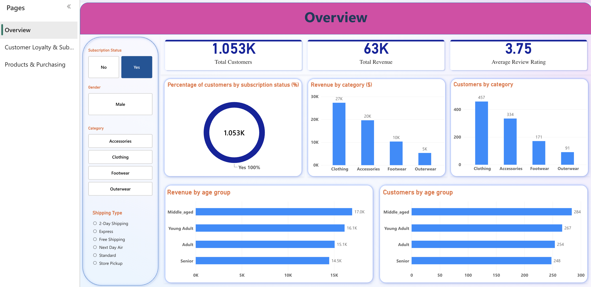

# Customer Shopping Behavior Analysis

<p align="center">
  <strong>FROM RAW CUSTOMER DATA TO RETAIL BUSINESS INSIGHTS</strong>
</p>

<p align="center">
  An end-to-end data analytics project exploring customer spending, loyalty, subscriptions, discounts, and product performance using Python, PostgreSQL, and Power BI.
</p>

<p align="center">
  
  
  
</p>

<p align="center">
  <a href="docs/project_overview.md">Project Overview</a> ·
  <a href="docs/business_insights.md">Key Insights</a> ·
  <a href="docs/power_bi_dashboard.md">Dashboard Guide</a>
</p>

---

## 01 — Inside the Numbers

<p align="center">
  
</p>

<p align="center">
  <em>Turning 3,900 customer records into a clearer picture of retail purchasing behavior.</em>
</p>

<table>
  <tr>
    <td align="center" width="25%">
      <strong>3,900</strong><br />
      <sub>Customer Records</sub>
    </td>
    <td align="center" width="25%">
      <strong>$233,081</strong><br />
      <sub>Total Revenue</sub>
    </td>
    <td align="center" width="25%">
      <strong>$59.76</strong><br />
      <sub>Average Purchase</sub>
    </td>
    <td align="center" width="25%">
      <strong>3.75 / 5</strong><br />
      <sub>Average Rating</sub>
    </td>
  </tr>
</table>

## 02 — The Business Challenge

**What drives customer purchasing behavior, and where can a retailer find opportunities to improve engagement and loyalty?**

Retail businesses collect valuable customer data, but the real challenge is translating that data into decisions. Revenue alone cannot explain why customers buy, how loyalty develops, or whether promotional strategies are effective.

This project investigates customer demographics, purchasing frequency, product categories, subscriptions, discount usage, ratings, payment methods, shipping preferences, and seasonal patterns to uncover actionable business insights.

**The objective:** Move beyond reporting numbers to explain what they mean for retail strategy.

[Explore the full project background →](docs/project_overview.md)

## 03 — From Data to Decisions

The project follows an end-to-end analytics workflow, with each tool serving a distinct purpose.

<table>
  <tr>
    <td align="center" width="33%">
      <h3>01 · PREPARE</h3>
      <p><strong>Python</strong></p>
      <sub>Inspect data, handle missing values, engineer features, and prepare the dataset for analysis.</sub>
    </td>
    <td align="center" width="33%">
      <h3>02 · ANALYZE</h3>
      <p><strong>PostgreSQL</strong></p>
      <sub>Answer 10 business questions using aggregations, CASE expressions, CTEs, and window functions.</sub>
    </td>
    <td align="center" width="33%">
      <h3>03 · COMMUNICATE</h3>
      <p><strong>Power BI</strong></p>
      <sub>Build a three-page interactive dashboard to communicate patterns and support decisions.</sub>
    </td>
  </tr>
</table>

```text
     CUSTOMER DATA
     3,900 rows · 18 columns
             │
             ▼
     PYTHON · PREPARATION
     Cleaning & feature engineering
             │
             ▼
     POSTGRESQL · ANALYSIS
     10 business questions
             │
             ▼
     POWER BI · VISUALIZATION
     3 interactive dashboard pages
             │
             ▼
     BUSINESS INSIGHTS
     Findings & recommendations
```

### Technology stack

| Tool             | Role in the project                           |
| ---------------- | --------------------------------------------- |
| Python           | pandas, SQLAlchemy, psycopg2                  |
| PostgreSQL       | Business queries and analytical SQL           |
| Power BI Desktop | Interactive dashboard and visual storytelling |
| Jupyter Notebook | Reproducible data preparation                 |
| Git & GitHub     | Version control and project documentation     |

## 04 — Questions Behind the Analysis

Rather than exploring data without a clear direction, the analysis is guided by business questions.

| Business area          | Questions investigated                                         |
| ---------------------- | -------------------------------------------------------------- |
| Revenue & demographics | Which customer groups generate the most revenue?               |
| Customer loyalty       | How are customers distributed by purchase history?             |
| Subscriptions          | How does subscription status vary across customer segments?    |
| Discounts              | Do customers who use discounts spend more?                     |
| Product performance    | Which products receive the highest and lowest ratings?         |
| Category performance   | Which product categories contribute most to revenue?           |
| Purchasing patterns    | How do seasons, shipping options, and payment methods compare? |

The results are translated into insights and recommendations rather than presented as isolated SQL outputs.

## 05 — Findings That Matter

<details>
<summary><strong>01 · Revenue concentration does not mean higher individual spending</strong></summary>

Male customers account for **$157,890, or 67.7% of revenue**, while making up approximately 68% of the dataset.

However, average spending is similar between men ($59.54) and women ($60.25).

**Business implication:** The revenue gap is primarily associated with customer representation in the dataset, not a substantial difference in average purchase value.

</details>

<details>
<summary><strong>02 · Discount usage and subscriptions are closely connected</strong></summary>

All 1,053 subscribers in the dataset also used a discount. Discount use and subscription status are also concentrated entirely among male customers.

**Business implication:** Before designing gender-based campaigns, the retailer should validate these unusual patterns and check whether they reflect actual customer behavior or data collection issues.

</details>

<details>
<summary><strong>03 · Discounts do not correspond to higher average spending</strong></summary>

Among male customers, average spending is $59.28 for discount users and $59.98 for customers who did not use discounts.

Subscribers average $59.49, compared with $59.57 among non-subscribing male customers.

**Business implication:** Discount effectiveness should be evaluated using incremental revenue, conversion, margin, and repeat purchases—not discount usage alone.

</details>

<details>
<summary><strong>04 · Most customers have substantial purchase histories</strong></summary>

A total of **3,116 customers (79.9%)** have 11 or more previous purchases, while 83 customers (2.1%) have only one previous purchase.

Subscription rates increase from 18.1% among new customers to 27.9% among loyal customers.

**Business implication:** Retention strategies should be investigated alongside onboarding initiatives that help first-time buyers return.

</details>

<details>
<summary><strong>05 · Clothing is the largest revenue contributor</strong></summary>

Clothing generates **$104,264 (44.7%)** of total revenue, followed by Accessories ($74,200), Footwear ($36,093), and Outerwear ($18,524).

**Business implication:** Clothing deserves attention in merchandising and inventory planning, while the other categories may offer opportunities for cross-selling and targeted promotions.

</details>

<details>
<summary><strong>06 · Product ratings show limited separation</strong></summary>

Average product ratings range from 3.62 to 3.86. Gloves have the highest average rating (3.86), while Shirts have the lowest (3.62).

**Business implication:** Investigate product-level feedback and review counts before making major decisions based on these relatively small differences.

</details>

<details>
<summary><strong>07 · Seasonal and operational differences are modest</strong></summary>

Fall leads in revenue at $60,018, while Summer records $55,777. Average purchase values across shipping options range from $58.46 to $60.73.

**Business implication:** Seasonal campaigns may be worth testing, but the observed differences alone do not establish a strong seasonal effect or a causal relationship.

</details>

**Important:** These are descriptive findings from the available dataset. They do not establish statistical significance or causation.

[Read the complete findings, caveats, and recommendations →](docs/business_insights.md)

## 06 — Explore the Dashboard

Three interactive Power BI pages turn customer data into a visual business story, from overall performance to customer loyalty and purchasing patterns.

### 01 · Business Overview

<p align="center">
  <a href="https://github.com/xiaomyatminkyaw/customer_shopping_behavior_analysis/blob/55be307114ae4cfe82eafcb0c2821e5513c081fa/images/overview.png">
    
  </a>
</p>

An executive snapshot of retail performance, featuring key metrics, category revenue, and customer demographics.

### 02 · Customer Loyalty & Subscriptions

<p align="center">
  <a href="https://github.com/xiaomyatminkyaw/customer_shopping_behavior_analysis/blob/55be307114ae4cfe82eafcb0c2821e5513c081fa/images/loyalty.png">
    
  </a>
</p>

An exploration of customer segments, subscription behavior, purchase history, and discount usage.

### 03 · Products & Purchasing

<p align="center">
  <a href="https://github.com/xiaomyatminkyaw/customer_shopping_behavior_analysis/blob/55be307114ae4cfe82eafcb0c2821e5513c081fa/images/purchasing.png">
    
  </a>
</p>

A closer look at product ratings, seasonal revenue, payment preferences, and purchasing patterns.

**Explore the project files**

* [Power BI dashboard guide](docs/power_bi_dashboard.md)
* [Download the Power BI dashboard](dashboard/Customer_behavior_dashboard.pbix)
* [SQL business analysis](sql/customer_behaviour_analysis_v2.sql)
* [Python analysis notebook](notebooks/Customer_Shopping_Behavior_Analysis.ipynb)


## 07 — Reproduce the Analysis

Want to explore the workflow yourself? Follow these steps to reproduce the analysis locally.

### Prerequisites

* Python 3
* PostgreSQL
* Power BI Desktop
* Git

### Setup

**1. Clone the repository**

```bash
git clone https://github.com/xiaomyatminkyaw/customer_shopping_behavior_analysis.git
cd customer_shopping_behavior_analysis
```

**2. Install Python dependencies**

```bash
pip install pandas sqlalchemy psycopg2-binary jupyter
```

**3. Create the PostgreSQL database**

```sql
CREATE DATABASE customer_behavior;
```

Configure your connection credentials through environment variables or a local configuration file excluded from Git. Never commit database passwords or other secrets.

**4. Prepare the dataset**

Open and run:

```text
notebooks/Customer_Shopping_Behavior_Analysis.ipynb
```

Update the database connection for your own environment before running the notebook.

**5. Execute the business queries**

Run:

```text
sql/customer_behaviour_analysis_v2.sql
```

Compare the results with the expected outputs documented in the SQL script.

**6. Open the Power BI dashboard**

Open `dashboard/Customer_behavior_dashboard.pbix`, update its data source to your local PostgreSQL table, and refresh the data.

For additional detail, see the [data cleaning documentation](docs/data_cleaning.md) and [SQL analysis documentation](docs/sql_analysis.md).

## 08 — Project Structure

```text
customer_shopping_behavior_analysis/
│
├── README.md
├── data/
│   └── customer_shopping_behavior.csv
├── notebooks/
│   └── Customer_Shopping_Behavior_Analysis.ipynb
├── sql/
│   └── customer_behaviour_analysis_v2.sql
├── dashboard/
│   └── Customer_behavior_dashboard.pbix
├── screenshots/
│   ├── 01_overview.png
│   ├── 02_loyalty.png
│   └── 03_products.png
├── images/
│   └── overview_1.png
└── docs/
    ├── project_overview.md
    ├── data_cleaning.md
    ├── sql_analysis.md
    ├── business_insights.md
    └── power_bi_dashboard.md
```

## 09 — Limitations & Next Steps

Every analysis depends on the quality and scope of its data.

* **Limited time dimension:** One row per customer means trends over time and repeat-purchase sequences cannot be reconstructed.
* **No sales channel field:** Online and offline purchasing behavior cannot be compared.
* **Descriptive analysis:** Group differences have not been tested for statistical significance.
* **Potential data-quality issue:** The observed gender pattern in discount usage and subscriptions requires source validation.
* **No causal evidence:** The dataset cannot establish that discounts cause higher spending or loyalty.

### Potential extensions

* Validate anomalous patterns against the source data.
* Test group differences using appropriate statistical methods.
* Evaluate promotional performance using margin and incremental revenue.
* Incorporate transaction-level data for cohort, retention, and time-series analysis.

## 10 — What This Project Demonstrates

This project demonstrates an end-to-end analytics workflow: preparing data in Python, translating business questions into SQL, designing a multi-page Power BI dashboard, and communicating findings with business recommendations.

The focus is not just on what the numbers show, but on **what the business should investigate or do next**.

---

<p align="center">
  <strong>Customer Shopping Behavior Analysis</strong><br />
  <sub>Data preparation · SQL analytics · Business intelligence · Data storytelling</sub><br /><br />
  <strong>Myat Min Kyaw</strong><br />
  <sub>Master of Information Systems · INTI International University</sub>
</p>
