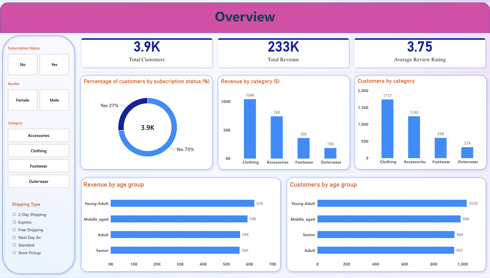
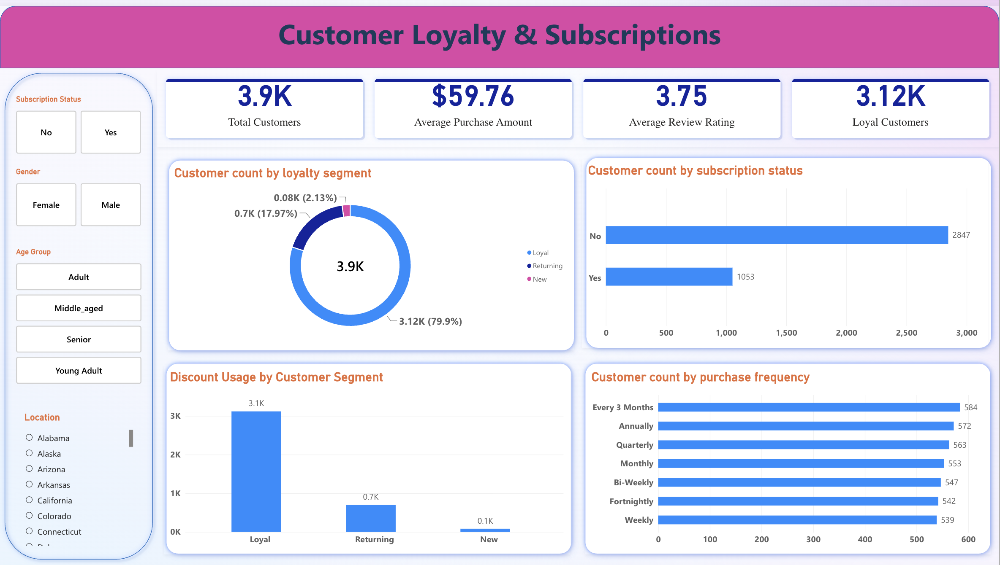
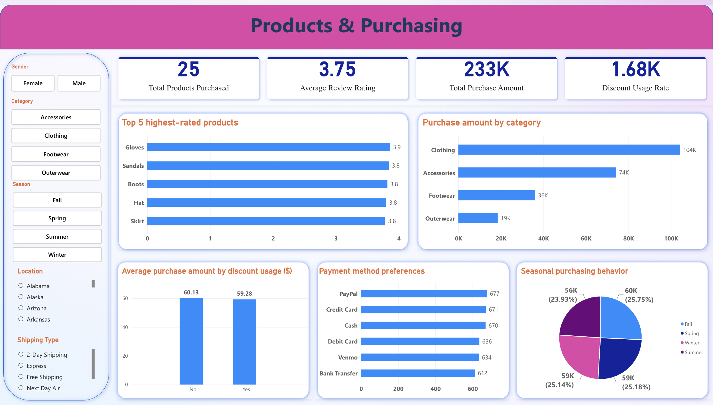

# Customer Shopping Behavior Analysis

  <strong>FROM RAW CUSTOMER DATA TO RETAIL BUSINESS INSIGHTS</strong>  
  An end-to-end data analytics project using Python, PostgreSQL, and Power BI to explore customer spending, loyalty, discounts, and purchasing behavior.

  
  
  

---

## 01 — Project Overview

How can a retailer use customer shopping data to improve sales, engagement, and loyalty?

This project analyzes **3,900 customer records** to identify purchasing patterns, evaluate discount and subscription behavior, compare product performance, and translate findings into actionable business recommendations.

## 02 — Inside the Numbers

<table>
  <tr>
    <td align="center" width="25%"><strong>3,900</strong> Customers</td>
    <td align="center" width="25%"><strong>$233,081</strong> Total Revenue</td>
    <td align="center" width="25%"><strong>$59.76</strong> Average Purchase</td>
    <td align="center" width="25%"><strong>3.75 / 5</strong> Average Rating</td>
  </tr>
</table>

## 03 — Analytics Workflow

| Stage       | Tools          | Deliverable                             |
| ----------- | -------------- | --------------------------------------- |
| Prepare     | Python, pandas | Cleaned dataset and feature engineering |
| Analyze     | PostgreSQL     | 10 business-focused SQL queries         |
| Visualize   | Power BI       | Three-page interactive dashboard        |
| Communicate | Markdown       | Insights and recommendations            |

## 04 — Dashboard Showcase

### Overview

  

### Customer Loyalty & Subscriptions

  

### Products & Purchasing

  

## 05 — Key Findings

* **Revenue:** Clothing contributes 44.7% of total revenue.
* **Customer loyalty:** 79.9% of customers have 11 or more previous purchases.
* **Discounts:** Discount users do not show higher average purchase amounts.
* **Subscriptions:** Subscribers and non-subscribers have similar average spending.
* **Data quality:** The unusual relationship between gender, discounts, and subscriptions requires further validation.

## 06 - Business Recommendations

Based on the analysis, the following actions could help retailers improve customer engagement, loyalty, and promotional effectiveness.

* **🎯 Refine Discount Strategies** — Discounts did not correspond to higher average spending among male customers. Test targeted promotions and compare purchase behavior before expanding discount campaigns.

* **💎 Strengthen Customer Loyalty** — With 79.9% of customers reporting 11 or more previous purchases, focus on retaining existing customers through loyalty rewards, personalized offers, and exclusive benefits.

* **📩 Improve Subscription Engagement** — Subscribers and non-subscribers showed similar average spending. Test subscription benefits and targeted campaigns to determine whether they can increase sign-ups and long-term engagement.

* **👕 Prioritize High-Revenue Categories** — Clothing generated 44.7% of total revenue. Maintain product availability in this category while exploring opportunities to grow Accessories, Footwear, and Outerwear.

* **⭐ Improve Lower-Rated Products** — Shirts received the lowest average rating (3.62/5), while Gloves received the highest (3.86/5). Investigate customer feedback on lower-rated products to identify potential improvements.

* **🔍 Validate Customer Data** — The dataset shows unusual patterns in discount usage and subscriptions across genders. Verify these records before using demographic findings to guide marketing decisions.

## 07 — Project Documentation

* [Project Overview](docs/project_overview.md)
* [Data Cleaning & Preparation](docs/data_cleaning.md)
* [SQL Analysis](docs/sql_analysis.md)
* [Business Insights & Recommendations](docs/business_insights.md)
* [Power BI Dashboard](docs/power_bi_dashboard.md)

**Project files:** [Python Notebook](notebooks/Customer_Shopping_Behavior_Analysis.ipynb) · [SQL Queries](sql/customer_behaviour_analysis_v2.sql) · [Power BI Dashboard](dashboard/Customer_behavior_dashboard.pbix)

---

  <strong>Myat Min Kyaw</strong> 
  Master of Information Systems · INTI International University

